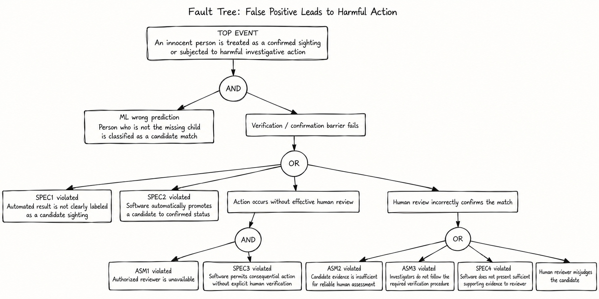
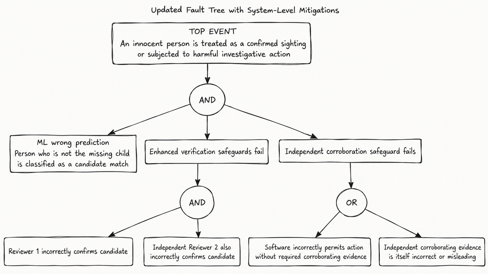

# Fault Tree Analysis and Mitigations

## Selected Requirement

This analysis focuses on the false-positive risk identified for the missing child and people captured in dashcam footage.

**Requirement:** People who do not match the missing child are not treated as confirmed sightings solely because of automated person-recognition outputs. Actions that may affect a person's liberty or privacy require independent human verification.

This requirement depends directly on the ML person-recognition component because an incorrect model prediction can create a false candidate sighting. System-level safeguards are therefore required to prevent an ML error from becoming a harmful real-world action.

## Original Fault Tree

The top event is an innocent person being treated as a confirmed sighting or being subjected to harmful investigative action. This requires an incorrect ML prediction together with a failure of the verification safeguards.

Possible safeguard failures include incorrect labeling of automated outputs, automatic promotion of candidates, unavailable human reviewers, failure to enforce human verification, insufficient evidence for review, failure to present supporting evidence, or human verification error.

## Mitigation Strategy 1: Independent Dual Review

For actions that could materially affect a person's liberty or privacy, require confirmation by two independent authorized reviewers.

A single reviewer error would therefore be insufficient to convert an incorrect ML prediction into a confirmed sighting. Both reviewers would have to independently accept the false candidate before the system allows escalation.

## Mitigation Strategy 2: Independent Corroborating Evidence

Before a confirmed sighting can trigger consequential action, require evidence independent of the original ML prediction, such as a second camera observation, additional video frames, an eyewitness report, or investigator verification from another source.

This creates another system-level barrier between a model error and real-world harm. Even when the recognition model produces a false positive and human review also fails, the sighting cannot trigger consequential action unless the corroboration requirement is also satisfied or bypassed.

## Updated Fault Tree

The updated tree adds two independent system-level safeguards. Harm now requires the original ML false positive, failure of the dual-review safeguard, and failure of the independent-corroboration safeguard. These mitigations reduce the probability that a single ML error or human-review error reaches the real world.